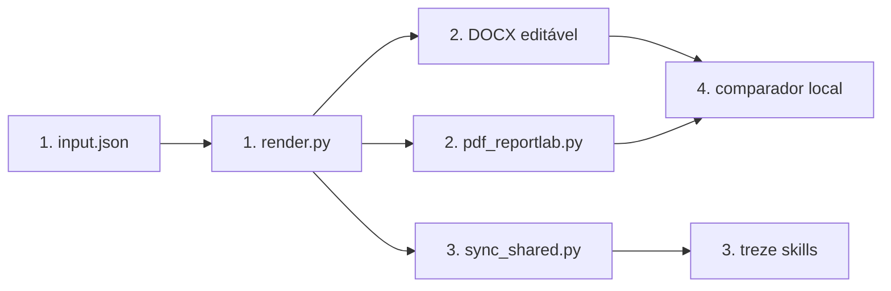

# Paridade visual DOCX/PDF dos entregáveis ERIC

**Approved**: 2026-10-28 - user: "aprovado pode continuar e preciso que vc de prioridade a presevar a edicao"
**Approved addendum**: 2026-10-29 - user: "vc consegue resolver o problema do corte do logo da ccee?"
**Approved addendum**: 2026-10-29 - user: "ha como aplicar o padding nos blocos azuis de titulo no docx???"
**Approved addendum**: 2026-10-29 - user: "verifique em todos os arquivos todos os lugarem em que isso esta diferente ... o texto nao ficou vertical center"

## Problem

Hoje, os DOCX gerados pelas skills exibem hierarquia, fontes, cores, colunas e paginação diferentes dos PDFs criados com o mesmo JSON. Na amostra do Briefing, o PDF tem uma faixa de pergunta e três colunas; o DOCX apresenta uma lista vertical de caixas. Na conversão com LibreOffice, a Avaliação IQB ocupa três páginas em vez de cinco, e o Relatório 4D ocupa duas em vez de três. Quem recebe o DOCX para editar não vê a mesma entrega que foi aprovada no PDF.

Ao concluir, a pessoa poderá abrir e editar o DOCX de cada tipo aplicável e reconhecer a mesma composição, sequência e conteúdo do PDF correspondente.

## Shape

O trabalho reutiliza o JSON canônico, os tokens e os layouts do renderizador compartilhado. As regras de composição ficam em `_DESIGN_SYSTEM/scripts/render.py` ou em módulo vizinho alcançado pelos testes de `_DESIGN_SYSTEM/tests/`; `_TOOLS/sync_shared.py` replica a versão aprovada às skills.

1. `input.json` (exists) entra em `_DESIGN_SYSTEM/scripts/render.py` (exists), que valida schema, perfil e conteúdo.
2. `_DESIGN_SYSTEM/scripts/pdf_reportlab.py` (exists) define estilos e composição PDF; o ramo DOCX de `render.py` (exists) aplica os mesmos tokens, medidas e ordem às estruturas editáveis.
3. `_TOOLS/sync_shared.py` (exists) distribui o renderizador às treze skills que geram entregáveis.
4. `_SAMPLES_ENTREGAVEIS/*/input.json` (exists) gera pares PDF/DOCX; um comparador local (new) converte os DOCX e registra páginas, geometria, fontes, cores e capturas para revisão.

**Changes underneath**

| Front | What changes |
| --- | --- |
| domain | Paridade visual passa a ser verificada por amostra e por layout, mantendo o mesmo conteúdo canônico. |
| stored data | Nenhum dado de projeto é migrado; amostras derivadas são regeneradas do JSON existente. |
| readers | As treze skills usam as cópias sincronizadas; os leitores de DOCX e PDF veem os derivados novos. |

Data: none - o renderizador usa arquivos locais, sem entidade persistida nova.

## Surface

None - a interface de `render.py` e os schemas consumidos pelas skills permanecem com a mesma assinatura.

## Landing

None - a mudança usa bibliotecas e formatos já existentes; não adiciona dependência nem altera o contrato do JSON.

## Criteria

### S1: Composição por tipo (P1)

Cada DOCX tem a composição visual do PDF gerado do mesmo JSON.

**Acceptance Criteria**

1. WHEN os 19 JSON de amostra com DOCX forem renderizados THEN o sistema SHALL produzir 19 pares PDF/DOCX, sem erro, com a orientação A4 do perfil e a mesma contagem de páginas por par após conversão DOCX para PDF em LibreOffice.
2. WHEN o Briefing de uma página for renderizado THEN o DOCX SHALL mostrar a pergunta em faixa azul, três cartões na mesma linha, faixa de responsáveis e identificação no rodapé, dentro de uma página A4 paisagem, seguindo os sete slots de `briefing_one_page.layout.json`.
3. WHEN um relatório ou registro em A4 for renderizado THEN o DOCX SHALL preservar a ordem dos blocos e a composição de faixas de seção, cartões, tabelas e fontes do PDF correspondente, com títulos e textos dentro da área segura do papel.
4. WHEN um Test Card ou Learning Card for renderizado THEN o DOCX SHALL mostrar os quatro campos na ordem do método em uma página A4 retrato, com rótulos e texto visíveis.
10. WHEN qualquer um dos 19 DOCX for convertido para revisão visual THEN o logo CCEE SHALL aparecer inteiro no cabeçalho, com a proporção da arte original e sem criar página extra.
11. WHEN uma faixa azul de título for renderizada em DOCX THEN o texto SHALL manter o padding do PDF em todos os tipos aplicáveis (12 pt horizontal e 9 pt vertical nos relatórios; 9 pt horizontal e 5 pt vertical nos cartões de fluxo), centralizado verticalmente, sem alterar a paginação do par.

### S2: Edição e identidade (P1)

Os documentos continuam úteis para quem precisa alterar o conteúdo.

**Acceptance Criteria**

5. WHEN um DOCX for aberto THEN o sistema SHALL manter texto, títulos, tabelas e cards como elementos editáveis do Word, e não como imagem de página inteira.
6. WHEN um mesmo JSON gerar PDF e DOCX THEN o sistema SHALL preservar título, ID, versão, estado, todos os blocos e citações aplicáveis em ambos os formatos, sem omissão nem duplicação.
7. IF uma fonte ou biblioteca necessária estiver ausente THEN o renderizador SHALL registrar o formato indisponível ou falhar explicitamente, sem anunciar paridade visual não verificada.

### S3: Distribuição e prova (P1)

O ajuste chega a todas as skills e pode ser rechecado.

**Acceptance Criteria**

8. WHEN a fonte compartilhada for sincronizada THEN as treze cópias distribuídas de `render.py` SHALL ter o mesmo hash da fonte, e `_TOOLS/sync_shared.py --check` SHALL sair com código 0.
9. WHEN a validação visual rodar THEN ela SHALL registrar, para cada um dos 19 tipos, páginas do PDF e DOCX convertido, diferenças de geometria/cores e imagem comparativa; qualquer par com página extra, página faltante ou conteúdo cortado SHALL reprovar.

## Out of scope

| Excluded | Why |
| --- | --- |
| `executive_presentation` | O perfil entrega PPTX e PDF, sem DOCX. |
| Alterar texto fictício, schemas, notas ou fontes de método | A solicitação trata da aparência dos formatos derivados. |
| Copiar o PDF como imagem única no DOCX | O contrato atual requer conteúdo editável, e o usuário priorizou preservar a edição. |

## Assumptions

| Assumption | Chosen default | Rationale | Confirmed? |
| --- | --- | --- | --- |
| Motor de comparação | LibreOffice headless com Montserrat disponível | Reproduzível no ambiente atual; arquivos Word podem ter pequenas diferenças de rasterização. | n |
| Referência visual | PDFs em `_SAMPLES_ENTREGAVEIS` gerados do mesmo JSON | São os pares existentes e a melhor fonte para a composição de cada tipo. | n |
| Prioridade entre edição e pixels exatos | Preservar texto, tabelas e cards editáveis | O usuário pediu: "preciso que vc de prioridade a presevar a edicao". | y |

**Open questions:** none - o usuário priorizou a edição integral.

## Differences from the source

None - os PDFs de amostra são a referência de composição; qualquer diferença aprovada será registrada aqui.

## Sources

- [`_DESIGN_SYSTEM/README.md`](../../../_DESIGN_SYSTEM/README.md) - binding - contrato de editabilidade, perfil e tokens.
- [`_DESIGN_SYSTEM/profiles.json`](../../../_DESIGN_SYSTEM/profiles.json) - binding - 19 tipos com DOCX e um tipo só com PPTX.
- [`_SAMPLES_ENTREGAVEIS`](../../../_SAMPLES_ENTREGAVEIS/README.md) - binding - 19 pares PDF/DOCX, todos fictícios, ligados aos respectivos `input.json`.
- [`briefing_one_page.layout.json`](../../../_DESIGN_SYSTEM/layouts/briefing_one_page.layout.json) - binding - sete slots do Briefing.
