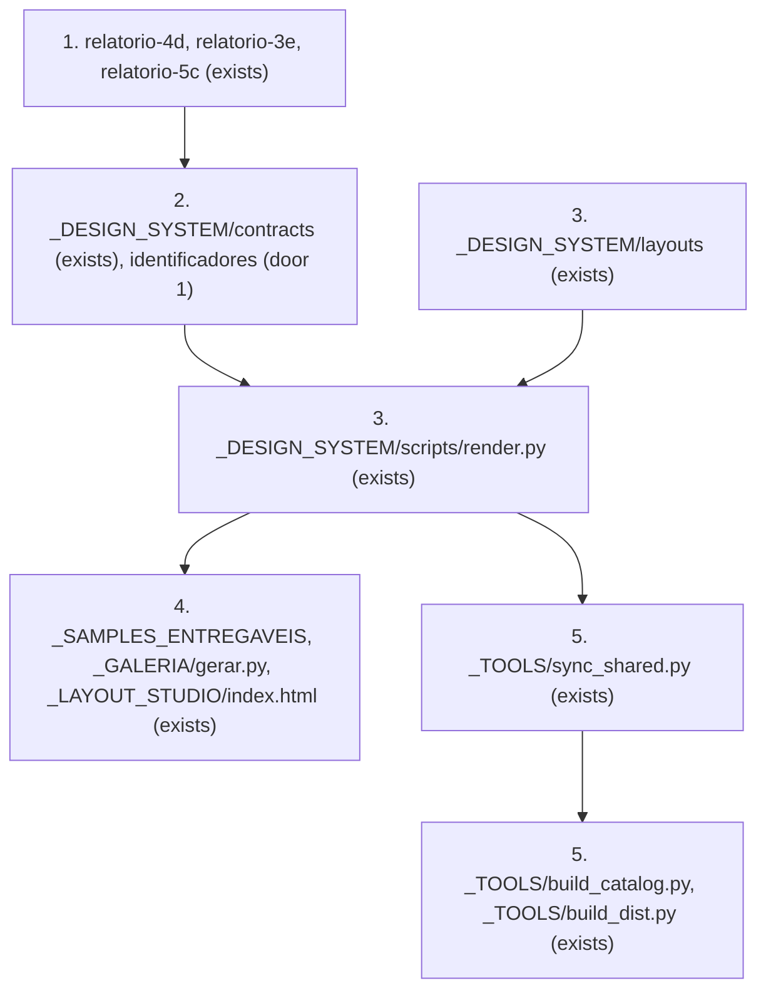
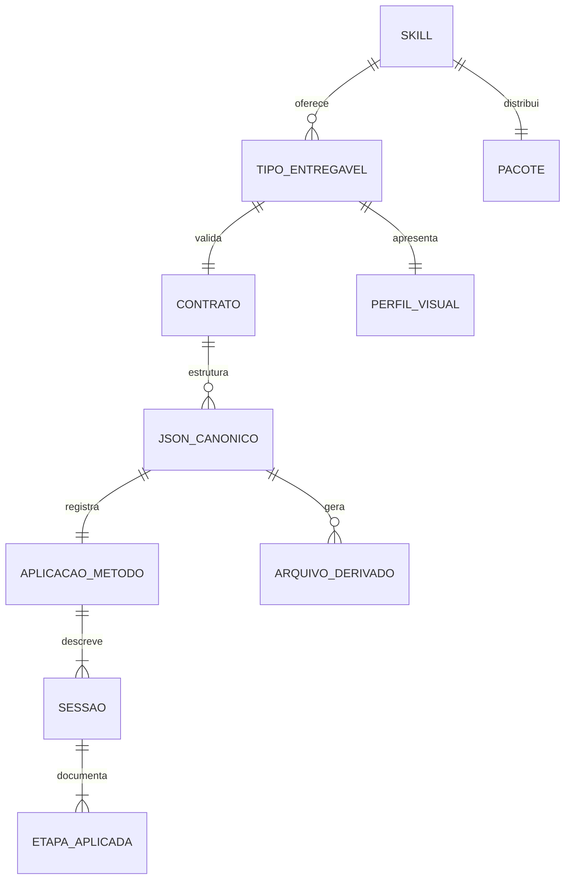

# Relatórios e apresentações oficiais 4D, 3E e 5C

**Approved**: 2026-11-17 - user: "aprovado"

## Problem

Os relatórios e apresentações atuais não exigem integralmente a receita fornecida pelo usuário. A finalidade, a trajetória do projeto, o racional das escolhas, a descrição e o desfecho de cada etapa e o fechamento executivo dependem de interpretação. Quem produz ou revisa as entregas não consegue conferir esses requisitos pelo contrato atual.

Com esta mudança, cada uma das três skills oferece Relatório oficial e Apresentação oficial como padrão. Os dois entregáveis anteriores continuam acessíveis como Relatório depreciado e Apresentação depreciada. Cada família mantém a mesma base de evidências nas duas saídas oficiais.

Oficial identifica a receita do entregável e o playbook de referência; não impõe que toda aplicação tenha todas as etapas ou os mesmos significados. A orientação do usuário nesta revisão substitui a sequência 5C do pedido inicial: o padrão vem sempre do playbook, com adaptações e versões pocket documentadas nos três métodos. O tom dos seis entregáveis oficiais vem do exemplo de apresentação 5C da autora, com densidade adequada a relatório ou slides.

## Shape

Reutilizar os motores, fontes, tokens e componentes do design system central, com novos perfis, contratos e layouts. As regras de conteúdo e ordem ficam nos contratos e validadores alcançados pelos testes de manutenção.

O contrato mantém a estrutura editorial comum, mas determina os blocos de etapas pelo inventário da aplicação, por sessão, conforme door 4. Uma referência compartilhada de tom, distribuída com as três skills, deriva do exemplo da autora; a revisão editorial usa evidências do texto e julgamento do Verifier, sem confundir contagem de palavras com avaliação de tom.

1. Pedido e fontes entram em `relatorio-4d`, `relatorio-3e` ou `relatorio-5c` (exists); a skill seleciona oficial por padrão ou depreciado quando solicitado explicitamente.
2. A análise gera JSON canônico no contrato específico de `_DESIGN_SYSTEM/contracts` (exists), com os novos identificadores (door 1).
3. `_DESIGN_SYSTEM/scripts/render.py` (exists) valida e deriva documentos e slides usando `_DESIGN_SYSTEM/layouts` (exists).
4. `_SAMPLES_ENTREGAVEIS` (exists), `_GALERIA/gerar.py` (exists) e `_LAYOUT_STUDIO/index.html` (exists) oferecem os novos modelos e identificam os antigos como depreciados.
5. `_TOOLS/sync_shared.py` (exists) distribui a fonte central; `_TOOLS/build_catalog.py` (exists) e `_TOOLS/build_dist.py` (exists) atualizam versões, catálogo e pacotes locais.

**Changes underneath**

| Front | What changes |
| --- | --- |
| domain | Pedido genérico de relatório ou apresentação nas três skills passa a selecionar o oficial. Os nomes visíveis dos seis tipos anteriores recebem a identificação depreciado. O playbook fornece o padrão metodológico; a aplicação documentada determina as etapas cobertas e seu significado. |
| stored data | Seis novos tipos e amostras são acrescentados, com inventário de aplicação por sessão para variantes integrais, adaptadas e pocket. JSONs anteriores mantêm seus identificadores e conteúdo; não há migração destrutiva. |
| readers | Skills, renderer, galeria, Layout Studio, amostras, catálogo e instaladores dos pacotes recebem os novos tipos. As cópias do design system nas demais skills também serão sincronizadas. |

New: seis tipos oficiais, seus contratos, perfis, layouts e amostras; aplicação do método com sessões e etapas aplicadas conforme door 4. Identificadores persistentes novos conforme door 1; os seis anteriores são preservados.

## Surface

None - nenhuma API HTTP nova. A interface consumida é o JSON do renderer existente e os nomes de seleção das skills. O comando existente mantém seus argumentos; entrada inválida retorna código diferente de 0 e explica o requisito faltante antes de gerar derivados.

## Landing

| One-way door | Literal shape | Alternative rejected |
| --- | --- | --- |
| 1. Identificadores de entregáveis | `four_d_official_report`, `four_d_official_presentation`, `three_e_official_report`, `three_e_official_presentation`, `five_c_official_report`, `five_c_official_presentation`; preservar `four_d_report`, `four_d_presentation`, `three_e_report`, `three_e_presentation`, `five_c_report`, `five_c_presentation` para os depreciados | Reutilizar os seis identificadores antigos com outra receita: mudaria o significado dos JSONs já existentes. |
| 2. Contrato das etapas oficiais | Relatório: `purpose`, `introduction`, `structuring`, depois `<id_etapa_aplicada>_description`, `<id_etapa_aplicada>_execution`, `<id_etapa_aplicada>_outcome` por etapa na ordem declarada, `conclusion`, `recommendations`. Apresentação: `challenge_context`, `structuring`, `execution_<id_etapa_aplicada>` na mesma ordem, `conclusion`, `recommendations`, `decision` quando aplicável, `call_to_action`. Os IDs vêm da door 4; nomes e quantidade do playbook são o padrão, não uma restrição às aplicações adaptadas. | Um parágrafo livre por etapa não verifica descrição, execução e desfecho; uma lista fixa obrigatória de D1 a D4, E1 a E3 ou C1 a C5 rejeitaria versões pocket legítimas. |
| 3. Decisão condicional da apresentação | `metadata.decision_required: true` exige `decision` com pedido de deliberação; `false` permite omitir esse slide. Ambos explícitos nas apresentações oficiais completas. | Omitir silenciosamente quando não há informação: confundiria ausência de decisão necessária com ausência de registro. |
| 4. Inventário da aplicação | `metadata.method_application.sessions`: lista ordenada de sessões com `id`, `variant` (`standard`, `adapted` ou `pocket`), `stages` (lista ordenada com `id`, `label`, `meaning`, `official_stage_ids`), `out_of_scope_stages` (IDs oficiais e motivos) e `adaptation_reason`. IDs de etapas aplicadas são únicos no documento. Correspondência com etapas oficiais pode ser múltipla ou vazia; ausência de correspondência exige explicação na estruturação. | Inferir aplicação só pela letra ou usar uma variante global sem sessões: perde mudanças de significado e confunde a cobertura da sessão curta com a da sessão completa. |

## Criteria

### S1: Escolher e consultar os seis modelos oficiais (P1)

**Acceptance Criteria**

1. WHEN uma das três skills recebe pedido genérico de relatório THEN a skill SHALL selecionar o Relatório oficial do respectivo método.
2. WHEN uma das três skills recebe pedido genérico de apresentação THEN a skill SHALL selecionar a Apresentação oficial do respectivo método.
3. WHEN o usuário pede Relatório depreciado ou Apresentação depreciada THEN a skill SHALL selecionar o respectivo tipo antigo, com identificador e contrato anteriores preservados.
4. WHEN um dos seis tipos antigos é exibido nas skills, galeria, amostras ou cabeçalho renderizado THEN o sistema SHALL identificá-lo como Relatório depreciado ou Apresentação depreciada, acompanhado de 4D, 3E ou 5C.
5. WHEN a galeria é gerada THEN o sistema SHALL oferecer os quatro entregáveis de cada skill de relatório, com os oficiais antes dos depreciados, mantendo também o Test Card da skill 3E.
6. WHEN o mantenedor escolhe um novo tipo no Layout Studio THEN o sistema SHALL oferecer suas seções canônicas e seu layout editável, com etapas padrão do playbook e suporte à configuração de etapas aplicadas nas variantes adaptadas e pocket.

### S2: Produzir o Relatório oficial na receita solicitada (P1)

**Acceptance Criteria**

7. WHEN um relatório oficial é gerado THEN o sistema SHALL exibir título e legenda que explique sua finalidade antes da introdução.
8. WHEN um relatório oficial completo é validado THEN o sistema SHALL exigir introdução que conecte origem do desafio, briefing disponível, preparação, execução e direcionamento, indicando explicitamente antecedentes inexistentes.
9. WHEN um relatório oficial completo é validado THEN o sistema SHALL exigir estruturação com racional do método, formato, participantes e critérios de seleção, etapas ou seções e ferramentas, sem inventar justificativas ausentes.
10. WHEN um Relatório oficial 4D é composto para aplicação padrão THEN a skill SHALL organizar D1 Descongelar, D2 Diagnosticar, D3 Desenhar e D4 Decidir, nesta ordem e com os significados do playbook 4D.
11. WHEN um Relatório oficial 3E é composto para aplicação padrão THEN a skill SHALL organizar E1 Esclarecer, E2 Estruturar e E3 Experimentar, nesta ordem e com os significados do playbook 3E.
12. WHEN um Relatório oficial 5C é composto para aplicação padrão THEN a skill SHALL organizar C1 Contextualizar, C2 Compreender, C3 Confirmar, C4 Cocriar e C5 Conduzir, nesta ordem e com os significados do playbook 5C.
13. WHEN qualquer etapa aplicada de relatório oficial é validada THEN o sistema SHALL exigir três conteúdos visíveis distintos: descrição da etapa no significado utilizado, execução realizada e desfecho, com as chaves definidas na door 2.
14. WHEN um relatório oficial completo é validado THEN o sistema SHALL exigir conclusão final que sintetize análise e resultados do trabalho realizado.
15. WHEN um relatório oficial completo é validado THEN o sistema SHALL exigir recomendações e próximos passos que distingam ações, decisões e aprovações pendentes, indicando responsáveis e prazos registrados ou a definir.
16. IF uma seção obrigatória contém apenas título ou espaços THEN a validação oficial SHALL rejeitar essa seção como conteúdo ausente.
17. IF faltam registros decisivos de execução ou desfecho de uma etapa incluída no escopo aplicado THEN a skill SHALL produzir versão parcial ou inconclusiva com a lacuna identificada, mantendo a receita das etapas aplicadas visível e sem declarar resultado inventado.
18. WHEN uma execução 4D, 3E ou 5C altera nome, ordem, significado, dinâmica, duração ou quantidade de etapas THEN a skill SHALL registrar padrão do playbook, aplicação efetiva, motivo, cobertura e fonte, preservando a cronologia sem forçar equivalência apenas pela letra.

### S3: Produzir a Apresentação oficial em modelo pitch (P1)

**Acceptance Criteria**

19. WHEN uma apresentação oficial é composta THEN a skill SHALL apresentar contextualização do desafio e trajetória, estruturação com o que é o método e por que foi aplicado, síntese da execução de cada etapa, conclusão, recomendações, decisão quando necessária e call to action, nesta ordem.
20. WHEN uma apresentação oficial é derivada do relatório oficial THEN a skill SHALL preservar a mesma base de fontes, achados, limites, recomendações e situação das decisões, com síntese de cada etapa incluída no escopo aplicado e a mesma identificação de sessões integrais, adaptadas ou pocket.
21. IF `metadata.decision_required` é `true` e falta o conteúdo do slide `decision` THEN o renderer SHALL rejeitar a apresentação oficial completa.
22. IF `metadata.decision_required` é `false` THEN o renderer SHALL aceitar apresentação oficial completa sem slide `decision`, mantendo recomendações e call to action obrigatórios.
23. IF a necessidade de decisão é desconhecida THEN a skill SHALL sinalizar a pendência em versão parcial, sem assumir `false` para declarar a apresentação completa.
24. WHEN a skill compõe o call to action THEN a skill SHALL explicitar a ação solicitada ao público, seu responsável ou destinatário e prazo registrado ou a definir.

### S4: Renderizar, distribuir e conferir os novos contratos (P1)

**Acceptance Criteria**

25. WHEN o renderer recebe cada um dos seis JSONs oficiais completos de exemplo THEN o sistema SHALL validar e gerar JSON, PDF e HTML, além de DOCX para relatório ou PPTX para apresentação, com o mesmo conteúdo obrigatório.
26. WHEN um novo modelo é renderizado THEN o sistema SHALL reutilizar logo, fontes, cores, componentes e hierarquia existentes, com relatório A4 paisagem e apresentação 16:9, usando layout específico por tipo e sem reduzir fontes para esconder excesso de conteúdo.
27. WHEN uma apresentação oficial é validada THEN o sistema SHALL exigir títulos de conteúdo de 4 a 14 palavras, até 4 blocos e 140 palavras por slide, permitindo dividir seções extensas em mais slides sem o limite legado de seis slides.
28. WHEN os modelos de exemplo são publicados localmente THEN o sistema SHALL incluir seis novos `input.json`, seus derivados e manifestos em `_SAMPLES_ENTREGAVEIS`, identificando dados como fictícios.
29. WHEN as cópias compartilhadas e os pacotes são reconstruídos THEN as verificações de sincronização, catálogo e distribuição SHALL retornar código 0, com versões atualizadas para todas as skills cujo conteúdo distribuível mudou.
30. WHEN os tipos depreciados são exercitados com os JSONs anteriores THEN o renderer SHALL continuar aceitando os contratos antigos e gerando seus derivados, com a identificação depreciado como única alteração intencional de nomenclatura.
31. IF a entrada oficial viola presença, ordem, conteúdo textual, referências ou decisão condicional THEN o renderer SHALL retornar código diferente de 0 antes de criar derivados finais daquela entrada.

### S5: Relatar aplicações adaptadas e pocket nos três métodos (P1)

**Acceptance Criteria**

32. WHEN uma aplicação pocket cobre apenas parte das etapas do playbook por desenho documentado THEN o sistema SHALL aceitar relatório e apresentação oficiais completos no escopo aplicado, sem exigir conteúdo das etapas excluídas e sem marcar a entrega como parcial apenas por essa redução.
    - 5C remoto com C1 a C3, sem C4 e C5 por desenho, com fontes e desfechos registrados: completo no escopo pocket.
    - 4D pocket com D1 e D2 ou 3E pocket com E1 e E2, com escopo e exclusões documentados: completo no escopo pocket, sem presumir decisão ou experimento inexistentes.
33. IF uma etapa está prevista no escopo aplicado e não tem registro THEN a skill SHALL identificá-la como lacuna, sem reclassificá-la como fora do escopo para declarar completude.
34. WHEN há sessões com profundidades distintas na mesma aplicação THEN o sistema SHALL preservar a cobertura e os achados de cada sessão, sem atribuir cocriação, votação ou decisão à sessão que não as realizou.
35. WHEN uma letra tem significado diferente do playbook na execução documentada THEN os dois entregáveis oficiais SHALL apresentar esse significado e sua relação ou ausência de correspondência com o padrão, sem rejeitar a adaptação por divergência nominal.
36. WHEN os exemplos e a verificação da feature são preparados THEN a implementação SHALL incluir casos integrais, adaptados e pocket para os três métodos, além do caso combinado 5C remoto de três Cs com sessão presencial de cinco Cs.

### S6: Aplicar o tom da autora aos seis entregáveis oficiais (P1)

**Acceptance Criteria**

37. WHEN qualquer uma das três skills compõe um dos seis entregáveis oficiais THEN a skill SHALL aplicar uma referência comum de tom derivada de `relatorio-5c/references/exemplos/5c-oficial-sessao-coletiva-apresentacao.md`, disponível também nas skills 4D e 3E instaladas isoladamente.
38. WHEN o texto oficial é redigido THEN a skill SHALL usar linguagem simples, direta e analítica, títulos que expressem um achado, exemplos concretos e leitura sustentada pelas fontes, com parágrafos curtos e densidade maior no relatório que nos slides.
39. WHEN o material contém contagens, inferências ou propostas THEN a skill SHALL explicitar denominador e regra das contagens, separar relato de consequência a examinar e apresentar benefícios esperados como hipóteses, com ressalvas junto da afirmação afetada e verbos neutros.
40. WHEN um bloco analítico tem evidências disponíveis THEN a skill SHALL combinar afirmação, evidências e linha de leitura, seguindo a lógica do exemplo da autora sem impor três evidências quando as fontes não as oferecem.
41. WHEN os seis modelos oficiais são revisados THEN o Verifier SHALL avaliar o tom de cada um contra a referência da autora, registrando trechos e eventuais desvios, sem copiar os achados, números ou contexto do exemplo 5C para os exemplos 4D e 3E.

## Out of scope

| Excluded | Why |
| --- | --- |
| Reescrever os playbooks originais ou modificar as três skills de facilitação dos workshops | Os playbooks permanecem o padrão. O pedido aplica às três skills de relatório a capacidade de relatar adaptações e versões pocket, com significado e escopo documentados. |
| Converter JSONs históricos para a receita oficial automaticamente | Preservar os entregáveis anteriores foi solicitado; correspondência de evidências exige análise. |
| Gerar relatórios de um projeto real | Não foram fornecidos registros de uma execução; os novos JSONs demonstrativos usam dados fictícios. |
| Deploy de site ou aplicação | O usuário autorizou commit, merge e push ao GitHub após os testes passarem; não solicitou deploy. |
| Alterar as especificações de paridade PPTX/PDF já modificadas no workspace | São alterações preexistentes do usuário, fora desta feature. |

## Assumptions

| Assumption | Chosen default | Rationale | Confirmed? |
| --- | --- | --- | --- |
| Orientação dos relatórios | A4 paisagem | É o perfil dos relatórios atuais usado como inspiração visual. | n |
| Identificação dos antigos | Preservar IDs técnicos e acrescentar depreciado ao nome visível | Mantém compatibilidade dos JSONs e torna a escolha explícita. | n |
| Configuração de verificação | Três mutações e Verifier independente após implementação | Padrão do tlc-spec-lean solicitado; não há configuração local diferente. | n |
| Padrão metodológico nas três skills | Usar sequência e significados do playbook; admitir adaptações e versões pocket documentadas | Usuário: "use como padrao oficial sempre o que esta no playbook, porem podem haver adapacoes". | y |
| Tom dos seis oficiais | Tom analítico, concreto e calibrado do exemplo de apresentação 5C da autora | Usuário: "aplicar o tom que vc conseguiu identificar no exemplo de apresentacao 5c da autora do playbook para todos os 6 entregaveis oficiais". | y |

**Open questions:** none - a proposta acima explicita as escolhas para a revisão do plano; não há outra dependência de informação antes dessa revisão.

## Differences from the source

None - a receita textual segue a correção posterior do usuário: padrão metodológico dos playbooks, aplicações adaptadas e pocket admitidas nos três métodos e tom da autora nos seis oficiais. A enumeração 5C do pedido inicial foi substituída por essa orientação expressa. Os modelos visuais atuais permanecem inspiração.

## Sources

- Pedido do usuário de 17/11/2026 nesta conversa: receita dos oficiais, manutenção dos antigos como depreciados e uso de tlc-spec-lean. Binding quanto ao conteúdo solicitado.
- Correção do usuário nesta conversa: "no 5c oficial deve seguir a sequencia oficial do playbook"; "as letras/fases do processo podem sofrer alteracao de aplicacao ou mesmo de significado"; versões pocket nos três métodos e tom da autora nos seis oficiais. Binding; substitui a sequência 5C inicialmente listada e amplia a flexibilidade dos critérios de cobertura.
- Modelos visuais existentes: non-binding - user: "devera se inspirar visualmente nos modelos ja existentes mas usando a receita oficial para definir o conteudo".
- `relatorio-4d/SKILL.md` e `relatorio-4d/references/4d-workshop-playbook.md`: método 4D e entregas anteriores.
- `relatorio-3e/SKILL.md` e `relatorio-3e/references/3e-solution-structuring-playbook.md`: método 3E, rastreabilidade e Test Cards.
- `relatorio-5c/SKILL.md`, `relatorio-5c/references/metodo-5c.md` e `relatorio-5c/references/entregas-5c.md`: sequência oficial do playbook, adaptações, fontes e entregas anteriores.
- `relatorio-5c/references/exemplos/5c-oficial-sessao-coletiva-apresentacao.md` e `relatorio-5c/references/escrita-relatorio-5c.md`: referência de tom para os seis oficiais e caso de profundidades diferentes; usar linguagem e raciocínio, sem copiar conteúdo ou impor a quantidade de evidências do exemplo.
- `_TOOLS/README.md`, `_DESIGN_SYSTEM/README.md`, `_GALERIA/gerar.py` e `_LAYOUT_STUDIO/README.md`: fonte central, cópias, leitores e distribuição.
- `.specs/STATE.md`, AD-001 active: preservar proteção de main; publicação no GitHub autorizada posteriormente pelo usuário, respeitando a proteção de main.

- Autorização posterior do usuário nesta conversa: "apos finalizar os testes se deu tudo ceto suba a versao final para o github via commit merge e push". Publicar somente após testes e verificação concluídos.
