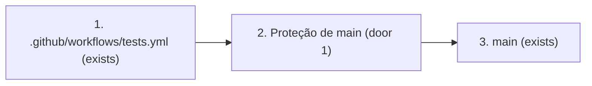
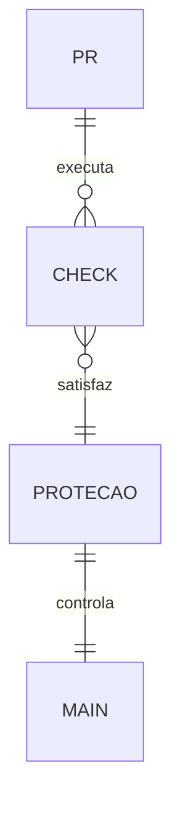

# Proteção do main

**Approved**: 2026-10-29 - user: "3"

## Problem

O branch `main` aceita push direto. Mesmo com o CI de pacotes, um commit com `_SKILLS_PRONTAS/` desatualizada pode entrar no branch antes que o teste falhe. Depois desta mudança, só um PR com os checks de versionamento e testes aprovados entra no `main`.

## Shape

Reutilizamos os jobs existentes do workflow `Testes`. A regra que decide o merge fica na proteção do branch no GitHub, conferida por leitura da API.

1. Commit em branch de trabalho -> `.github/workflows/tests.yml` (exists) - executa `versionamento` e `testes` no PR.
2. Resultados dos jobs -> proteção de `main` no GitHub (door 1) - exige PR, dois checks atualizados e aplica a regra a administradores.
3. Proteção de `main` (door 1) -> `main` (exists) - aceita merge somente após as condições.

**Changes underneath**

| Front | What changes |
| --- | --- |
| domain | Entrada em `main` passa a exigir PR e checks, inclusive para administradores. |
| stored data | Política de proteção gravada no GitHub; nenhum arquivo de skill muda. |
| readers | Mantenedor, GitHub PR e workflow de Release após merge. |

New: política remota de proteção para o branch `main`; nenhuma entidade de produto.

## Surface

None - only existing GitHub API endpoints are used; their signatures do not change.

## Landing

| One-way door | Literal shape | Alternative rejected |
| --- | --- | --- |
| Política de entrada no `main` | `required_status_checks: {strict: true, contexts: [versionamento, testes]}`; `required_pull_request_reviews: {required_approving_review_count: 0}`; `enforce_admins: true`; `allow_force_pushes: false`; `allow_deletions: false`; `restrictions: null` | Apenas CI após push: detecta divergência, mas não impede que ela entre no `main` |

## Criteria

### S1: Entrada protegida no main (P1)

O GitHub rejeita mudanças sem PR ou sem os dois checks aprovados.

**Acceptance Criteria**

1. WHEN a proteção é aplicada THEN o GitHub SHALL exigir PR para `main` com zero aprovações obrigatórias de revisores.
2. WHEN um PR tenta entrar no `main` THEN o GitHub SHALL exigir `versionamento` e `testes` bem-sucedidos em branch atualizado com `main` (`strict: true`).
3. WHEN um administrador tenta contornar a regra ou fazer force push/exclusão THEN o GitHub SHALL aplicar a proteção e negar force push/exclusão.
4. WHEN o mantenedor consulta a proteção pela API THEN a configuração SHALL retornar os valores dos critérios 1 a 3.

## Out of scope

| Excluded | Why |
| --- | --- |
| Aprovação obrigatória de outro usuário | A opção escolhida exige PR e checks, não revisão de terceiro. |
| Alterar as skills ou suas versões | A política controla a entrada dos pacotes já versionados. |

## Assumptions

| Assumption | Chosen default | Rationale | Confirmed? |
| --- | --- | --- | --- |
| Checks atualizados | `strict: true` | Evita merge validado contra um `main` antigo | n |

**Open questions:** none - all resolved or logged above.

## Differences from the source

None - no binding capture for this feature.

## Sources

- Usuário nesta conversa - binding - escolheu a opção 3: PR + `versionamento` + `testes`.
- [GitHub REST API de proteção de branches](https://docs.github.com/en/rest/branches/branch-protection) - fonte técnica para a forma da política.
