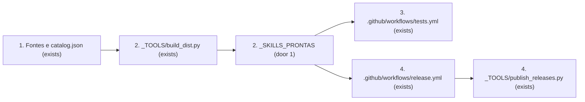
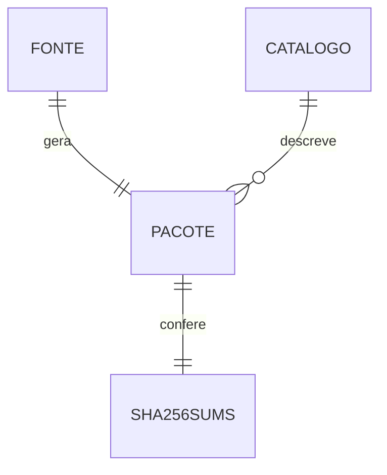

# Skills prontas versionadas

**Approved**: 2026-10-29 - user: "pode mudar o nome da pasta para _SKILLS_PRONTAS e adicione a veirficacao mas para tudo isso use a skill $tlc-spec-lean"

## Problem

Os arquivos `.skill` locais ficam em `_DIST/`, fora do Git. Quem instala pelo repositório precisa gerar os pacotes ou baixar uma Release; uma pasta local antiga pode divergir das fontes sem barrar o commit. O usuário quer baixar do repositório pacotes que correspondam à versão do código daquele commit.

## Shape

Reutilizamos o empacotador determinístico e o catálogo atuais. A regra de igualdade roda no próprio empacotador e na CI, onde os testes conseguem exercê-la.

1. Fontes das skills e `catalog.json` -> `_TOOLS/build_dist.py` (exists) - calcula os 14 pacotes, catálogo e hashes.
2. `_TOOLS/build_dist.py` (exists) -> `_SKILLS_PRONTAS/` (door 1) - grava o conjunto completo ou compara o conjunto versionado byte a byte.
3. `.github/workflows/tests.yml` (exists) -> `_TOOLS/build_dist.py --check` - rejeita divergência no pull request e no push.
4. `.github/workflows/release.yml` (exists) -> `_TOOLS/build_dist.py` e `_TOOLS/publish_releases.py` (exists) - publica os mesmos arquivos do commit validado.

**Changes underneath**

| Front | What changes |
| --- | --- |
| domain | Pacote pronto passa de artefato local ignorado a artefato versionado; `build_dist.py`, `publish_releases.py` e leitores da documentação usam o novo caminho. |
| stored data | Os 14 ZIPs, catálogo e SHA256SUMS entram no Git; nenhuma migração de dados pessoais. |
| readers | Pessoa que baixa pelo repositório; CI e workflow de Releases. |

New: arquivos versionados em `_SKILLS_PRONTAS/` para os 14 pacotes e dois manifestos.

## Surface

None - no HTTP route or external API signature; the CLI outcomes are fixed in Criteria.

## Landing

| One-way door | Literal shape | Alternative rejected |
| --- | --- | --- |
| Caminho público no Git | `_SKILLS_PRONTAS/<skill>.skill` para cada skill de `catalog.json`, mais `catalog.json` e `SHA256SUMS` | `_DIST/` ignorado: não oferece download direto pelo Git nem garantia no commit |

## Criteria

### S1: Pacotes prontos no commit (P1)

Quem acessa o repositório encontra o pacote correspondente ao código.

**Acceptance Criteria**

1. WHEN o mantenedor roda `python3 _TOOLS/build_dist.py` THEN o sistema SHALL gravar em `_SKILLS_PRONTAS/` exatamente um `.skill` para cada uma das 14 skills do catálogo, `catalog.json` e `SHA256SUMS`.
2. WHEN o mantenedor roda `python3 _TOOLS/build_dist.py --check` em um checkout íntegro THEN o sistema SHALL sair com código 0 sem alterar arquivos.
3. IF um pacote ou manifesto está ausente, alterado ou extra THEN `--check` SHALL sair com código 1 e nomear cada arquivo divergente.
4. WHEN uma skill sai do catálogo e o mantenedor reconstrói os pacotes THEN o sistema SHALL remover seu `.skill` antigo e atualizar `SHA256SUMS`.
5. WHEN um pull request ou push ao `main` contém fontes e pacotes divergentes THEN o job `versionamento` SHALL falhar antes da publicação.
6. WHEN a publicação roda THEN o sistema SHALL anexar os arquivos de `_SKILLS_PRONTAS/` sem depender de `_DIST/`.

## Out of scope

| Excluded | Why |
| --- | --- |
| Alterar conteúdo ou versão de uma skill | A mudança é no canal de distribuição; os pacotes preservam as versões atuais. |
| Publicar diretamente nesta tarefa | A autorização atual cobre alteração local; `git push` requer autorização específica pela skill. |

## Assumptions

| Assumption | Chosen default | Rationale | Confirmed? |
| --- | --- | --- | --- |
| Garantia de atualidade | Exigir igualdade no commit/CI; durante edição local, reconstrução explícita | Git não impede alterações temporárias no workspace | n |

**Open questions:** none - all resolved or logged above.

## Differences from the source

None - no binding capture for this feature.

## Sources

- Pedido do usuário nesta conversa - binding - nome da pasta e verificação de atualidade.
